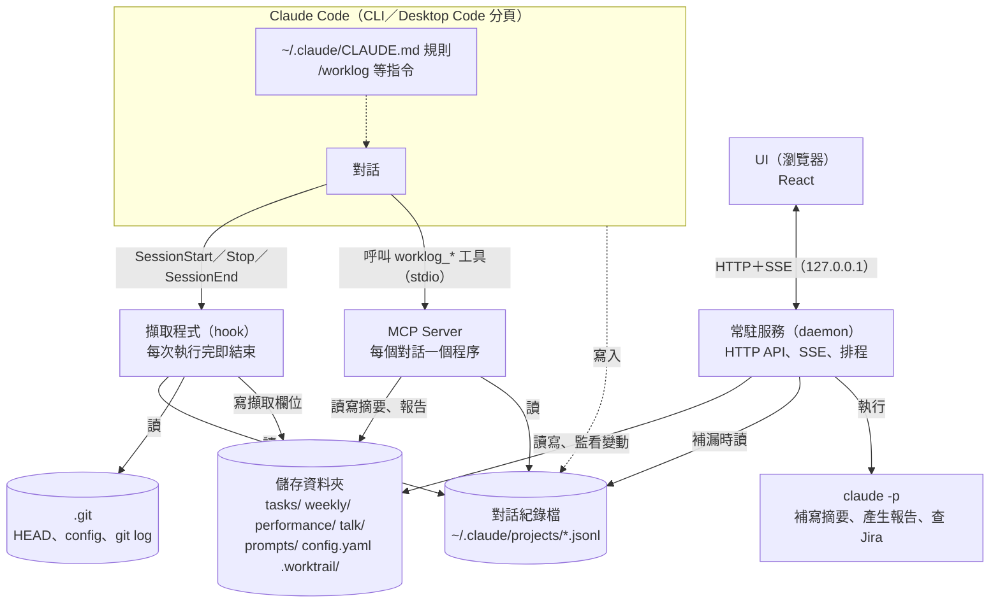
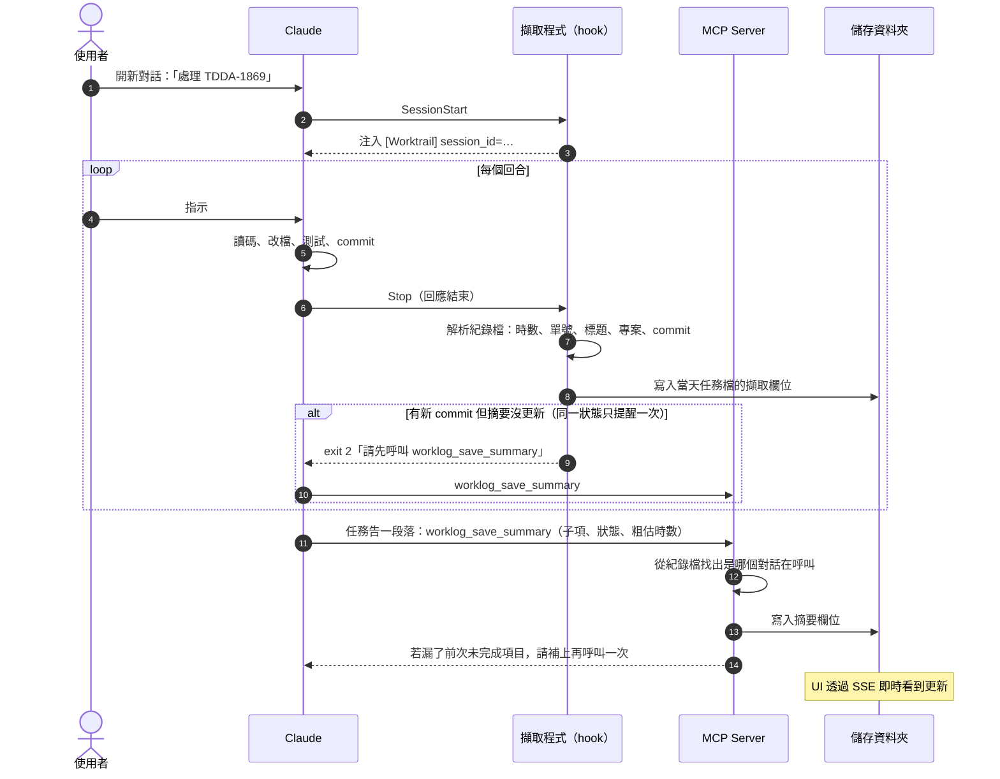
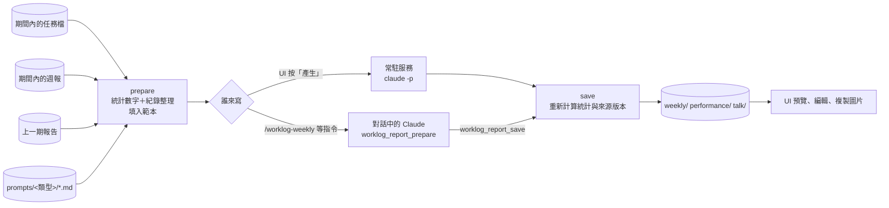
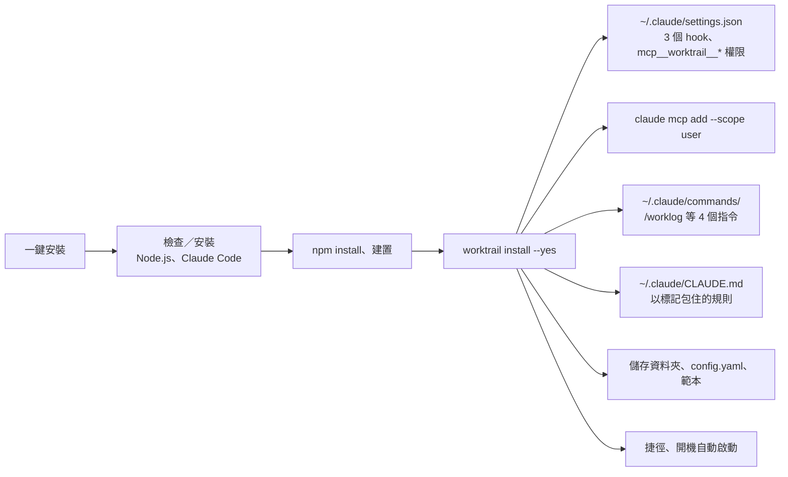

# Worktrail：架構與運作原理

本文說明 Worktrail 由哪些元件組成、一筆工作紀錄怎麼產生、報告怎麼寫出來。各項設計的取捨與歷次調整記在 [DECISIONS.md](DECISIONS.md)。

## 1. 核心想法

- **紀錄是開發過程的副產品**：不需要事後補寫。Claude Code 本來就會把每個對話存成紀錄檔（`~/.claude/projects/**/*.jsonl`），Worktrail 從這裡讀出時間、單號與 commit。
- **確定的事交給程式，需要理解的事交給 Claude**：時數、單號、專案、commit 由程式擷取，結果可預期、可測試；標題、子項、狀態與報告由 Claude 撰寫。
- **三層保險**：hook 每回合擷取 → Claude 寫摘要（有把關提醒）→ 每日掃描補漏。任何一層失效，下一層會接住。
- **一切都是本機 Markdown**：任務、週報、績效、範本都是儲存資料夾裡的 `.md` 檔，沒有資料庫，也沒有雲端服務。
- **一個 Claude Code 對話＝一個任務**，一天一個檔案。

## 2. 元件



| 元件 | 程式位置 | 生命週期 | 職責 |
| --- | --- | --- | --- |
| 擷取程式 | `src/hook/` | 由 Claude Code hook 啟動，2 秒內結束 | 解析紀錄檔、計算時數、辨識單號與專案、認領 commit、摘要把關 |
| MCP Server | `src/mcp/` | Claude Code 每個對話啟動一個 stdio 程序 | 提供 7 個 `worklog_*` 工具：寫摘要、查任務、準備與儲存報告、開啟 UI |
| 常駐服務 | `src/daemon/` | 開機自動啟動，或由 `worktrail open`、MCP 啟動 | 提供 UI 與 HTTP API、推送檔案變動、每日補漏、查詢 Jira 父卡片、呼叫 `claude -p` |
| UI | `ui/` | Edge／Chrome 的 app 模式獨立視窗 | 檢視與編輯任務、產生報告、管理範本與設定 |
| 安裝程式 | `src/installer/` | 一鍵安裝時執行 | 註冊 hook、MCP、指令、CLAUDE.md 規則、捷徑與開機啟動 |
| 核心邏輯 | `src/core/` | 由上述元件共用 | 所有業務邏輯，不依賴 MCP、HTTP 或 UI |

元件彼此不直接呼叫，透過儲存資料夾中的檔案交換資料，所以任何一個停止，其他元件仍能工作。多個元件可能同時寫同一個檔案（例如 Stop hook 與 MCP 同時更新任務），因此所有寫入都先取得檔案鎖，再以原子寫入完成。

UI 不放在 MCP Server 裡，是因為 MCP Server 是每個對話各自啟動的短期程序，多個對話同時開啟時無法共用同一個網頁埠號。

## 3. 一筆紀錄的一生



### 3.1 第一層：擷取（hook，不用 AI）

Claude Code 每個回合結束時觸發 Stop hook，執行 `worktrail hook stop`：

1. **解析紀錄檔**（`src/core/transcript/`）：把 Claude Code 的原始 JSONL 轉成標準化事件。這是唯一處理原始格式的地方，Claude Code 改格式時只需要改這裡。分叉對話複製過來的舊訊息會被標出，不重複計時。
2. **活躍時間**（`capture/active-time.ts`）：相鄰事件的間隔加總，超過 15 分鐘的間隔視為閒置，只補 2 分鐘；工具執行中的時間整段計入（有上限，避免被中斷的指令灌水）；依時區切分到各天。
3. **單號**（`capture/ticket.ts`）：從 Jira MCP 呼叫、第一則訊息、分支名稱、commit 訊息等來源計分，分數最高者為主單號。只出現在 Claude 回應裡的單號不算數。
4. **標題**（`capture/title.ts`）：摘要標題 → Jira 標題 → Desktop 對話標題 → 第一則訊息。
5. **專案**（`capture/project.ts`）：Jira 父卡片 → 工作目錄規則 → 單號代碼 → 最上層卡片標題 → 資料夾名稱。
6. **commit**（`capture/commits.ts`、`git.ts`）：優先認領對話中 `git commit` 輸出的 sha；直接讀 `.git` 檔案取得 HEAD 與作者，盡量不啟動 git。
7. **寫入**（`sync/capture-session.ts`、`merge.ts`）：只更新擷取欄位，不動摘要欄位與使用者鎖定的欄位。
8. **把關**（`sync/guard.ts`）：有實質進展（預設為新的 commit）但摘要沒更新時，以 exit 2 要求 Claude 先寫日誌。同一個進展狀態只提醒一次。

hook 的鐵則：任何錯誤都 exit 0（把關的 exit 2 除外），執行時間上限 2 秒，絕不因 Worktrail 擋住開發。紀錄檔大小與修改時間沒變時直接跳過。

### 3.2 第二層：摘要（Claude 撰寫）

- 安裝時在 `~/.claude/CLAUDE.md` 加入兩行規則：任務完成或告一段落時呼叫 `worklog_save_summary`。
- 摘要的撰寫規則來自預設摘要範本的「## 撰寫規則」段落，MCP 啟動時附在工具說明裡，所以 Claude 一次呼叫就能寫完。
- MCP 從紀錄檔尾端找出「尚未回覆的 `worklog_save_summary` 呼叫」，判斷是哪個對話在寫，Claude 不需要帶 session_id。
- 寫入後比對同單號前一次未完成的項目，漏掉的會請 Claude 補上。

### 3.3 第三層：補漏（常駐服務）

- 時機：服務啟動時、每天 `capture.sweep_time`（預設 18:00）、設定頁手動掃描。
- 掃描最近 7 天修改過的紀錄檔，對沒被擷取或落後的對話補做擷取。活躍時間不到 5 分鐘且沒有 commit 的對話不建立任務。
- 摘要狀態為 `draft`（未寫）或 `stale`（有新進度）的任務列入「待補摘要」。使用者按「補寫」時，把紀錄檔精簡（只留訊息、文字回應、工具名稱與檔案路徑）後交給 `claude -p` 產生摘要。

### 3.4 任務檔

每個對話每天一個檔案：`tasks/YYYY/MM/日期__單號__session前6碼.md`。前段 YAML 分兩組欄位，由不同的人負責：

| 欄位 | 誰寫 | 例子 |
| --- | --- | --- |
| 擷取欄位 | 擷取程式 | `repo`、`branch`、`first_activity`、`last_activity`、`active_minutes`、`commits` |
| 摘要欄位 | Claude（MCP）或補寫 | `title`、`items`（子項＋狀態）、`summary_status` |
| 可被使用者鎖定 | UI 修改後列入 `locked_fields` | `project`、`ticket`、`hours`、`title` |

時數的採用順序是「使用者修改 > AI 粗估 > 系統計算」，記在 `hours_source`。AI 是逐一任務各自粗估，同一天加總超過設定的每日工時（`time.daily_hours`，預設 8）時，`core/sync/day-hours.ts` 依比例縮減當天 AI 粗估的任務：原本的粗估留在 `hours_estimate`，`hours` 是調整後的值；使用者填寫與系統計算的時數不動、先占用工時。寫入摘要、在 UI 改時數、新增／刪除／復原任務，以及修改每日工時設定時都會重新分配。子項狀態有 `done`、`pending`、`todo`、`skipped`、`blocked` 五種。

## 4. 報告怎麼產生



- **統計由程式計算，文字由 Claude 撰寫**：時數、任務數、完成率等數字先算好放進 prompt，並註明「直接引用，不可自行重算」。
- 四種報告的來源：

  | 報告 | 輸入 | 期間 |
  | --- | --- | --- |
  | 小交流 | 勾選日期的任務 | 任意幾天（可不連續） |
  | 週報 | 期間內的任務＋上一期週報 | 一週或多週一期（雙週報） |
  | 績效 | 期間內的週報 | 月、季、半年或年 |
  | 摘要 | 單一對話的精簡紀錄 | 一個任務 |

- **過期偵測**：報告存下來源的 `sources_version`（來源 id＋內容雜湊）。之後任務有變動，UI 會標示報告可以更新。daemon 判斷過期與搜尋報告時，任務取自記憶體索引、報告取自只重讀變動檔案的快取（`ReportSource`），不每次重讀所有檔案。
- **範本**：`prompts/<類型>/` 下的 Markdown，使用 `{{records}}`、`{{stats}}`、`{{period}}` 等變數。內建範本唯讀，修改時自動另存成使用者的版本。

## 5. 與 Jira 的關係

Worktrail 本身不呼叫 Jira API，也不保存 Jira 帳密。需要 Jira 資料時，一律由 `claude -p` 透過使用者已連線的 Jira MCP 讀取，而且只開放唯讀工具（`atlassianUserInfo`、`getAccessibleAtlassianResources`、`searchJiraIssuesUsingJql`、`getJiraIssue`，各功能只開放需要的幾個）。

| 功能 | 做法 |
| --- | --- |
| 依父卡片分類專案 | 常駐服務每 10 分鐘查詢近期單號的標題與上層卡片，存到 `.worktrail/ticket-info.json`；hook 只讀快取，不連線 |
| 大型工作自動建立專案 | 查到最上層卡片後，自動以卡片標題建立專案 |
| 手動任務「從 Jira 整理」 | 取回當天的留言，由程式依留言內文的日期行過濾（內文沒寫日期的留言改看建立時間），再套用 `summary/jira` 範本整理成子項 |
| Jira 每日活動同步 | 每天（預設 18:00，啟動時補抓最近 7 天）以 JQL 找出當天跟我有關的單，讀取留言與 changelog；由程式（`src/core/jira-activity/`）只留「我、當天」的事件，沒有任務涵蓋的單建立 Jira 任務（`manual: true`、`source: jira`，預設 0.5 小時），已有同單號任務時把活動附加到它的補充說明。同步狀態存在 `.worktrail/jira-sync.json` |
| 複製 Jira 進度 | 只複製純文字到剪貼簿，由使用者自己貼上 |

## 6. 安裝時做了什麼



新建立的 `config.yaml` 帶有 `ui.onboarding: pending`，第一次開啟 UI 時先顯示引導頁（名字、Jira 代碼、報告週期、外觀與環境檢查），完成後改為 `done`。

所有修改都以標記包住或先備份，解除安裝時精準移除，不動使用者自己的設定。詳見 [安裝與解除說明](安裝與解除說明.md)。

## 7. 程式結構

```
src/
├─ core/            業務邏輯（不依賴 MCP、HTTP、UI），全部附 vitest 單元測試
│  ├─ transcript/   Claude Code 紀錄檔 → 標準化事件（唯一碰原始格式的地方）
│  ├─ capture/      活躍時間、單號、標題、專案、commit、git
│  ├─ sync/         擷取流程、把關、補漏、編輯、合併、手動任務、找出呼叫端
│  ├─ storage/      路徑、任務檔讀寫、原子寫入、檔案鎖、狀態
│  ├─ schema/       任務、設定、報告、範本的 zod schema
│  ├─ period/       週、多週、季等期間切分
│  ├─ stats/        統計數字
│  ├─ prompt/       範本載入與變數填入
│  ├─ report/       報告準備與儲存
│  ├─ summary/      補寫摘要、從 Jira 整理
│  ├─ talk/         小交流
│  ├─ onboarding/   首次引導：Jira 代碼候選、勾選結果、報告期間預覽
│  ├─ ticket-info/  Jira 父卡片快取
│  └─ claude-cli/   呼叫 claude -p
├─ hook/            hook 進入點
├─ mcp/             MCP Server 與工具定義
├─ daemon/          HTTP API、SSE、背景工作與排程
├─ installer/       安裝、解除、doctor
├─ launcher/        Windows 啟動器（不閃終端機視窗）
├─ templates/       CLAUDE.md 規則、內建範本
└─ cli.ts           worktrail 指令進入點
ui/                 React 19 + Vite + Tailwind 4，建置到 dist/ui
scripts/            建置、一鍵安裝腳本；demo/ 為示範資料與 GIF 錄製
test/               整合測試與去識別化的紀錄檔樣本
```

## 8. 開發

```bash
npm test             # 建置後端並執行所有測試（安裝流程在暫存資料夾中測試，不碰真實設定）
npm run typecheck    # 後端與 UI 型別檢查
npm run dev:ui       # UI 開發模式（需先以 worktrail open 啟動服務）
npm run coverage     # core/ 覆蓋率
npm run dev -- analyze <紀錄檔或資料夾> --table   # 分析紀錄檔，不寫入任何檔案
npm run demo:gif     # 以虛構資料重錄 README 的示範 GIF（需先 npm run build）
```

### 示範資料與 GIF

`scripts/demo/` 用來產生 README 的示範畫面，UI 改版後執行 `npm run demo:gif` 即可重錄 `docs/images/demo.gif`：

| 檔案 | 做什麼 |
| --- | --- |
| `run.mjs` | 一鍵流程：產生資料 → 以獨立的 `WORKTRAIL_HOME` 啟動示範服務 → 錄製 → 停止服務 |
| `seed.mts` | 虛構資料：電商團隊、單號 `SHOP`、三個專案、約半年的任務、上週週報與小交流。日期以執行當天為準 |
| `record.mjs` | 以無頭 Chrome／Edge 依序截取 6 個畫面，淡入淡出後自行編碼成 GIF，不需額外套件 |

- 全程使用系統暫存資料夾（`%TEMP%/worktrail-demo`），不碰真實的日誌與 `~/.claude`；各幕截圖留在 `shots/` 方便檢查。
- 可用環境變數調整：`DEMO_PORT`（預設 4879）、`DEMO_TODAY`（固定日期，例如 `2026-11-19`）、`DEMO_BROWSER`（瀏覽器路徑）、`DEMO_OUT`（輸出路徑）。
- 要改畫面順序或停留時間，改 `record.mjs` 的「劇本」段落；要改示範內容，改 `seed.mts`。

開發規則見專案根目錄的 [CLAUDE.md](../CLAUDE.md)。
